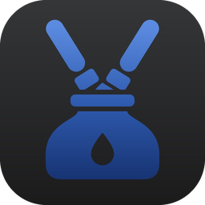
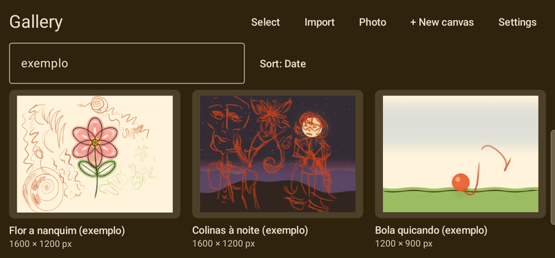
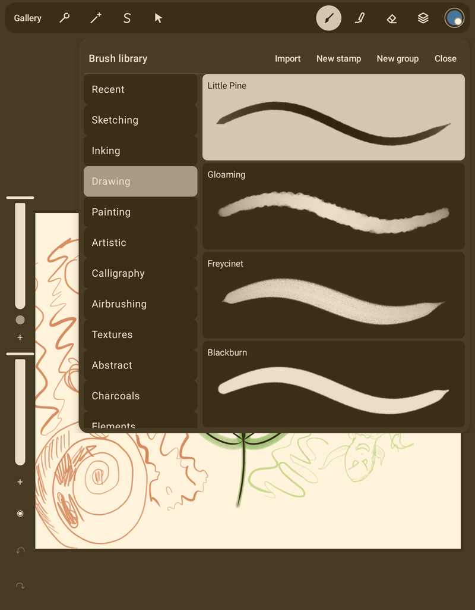
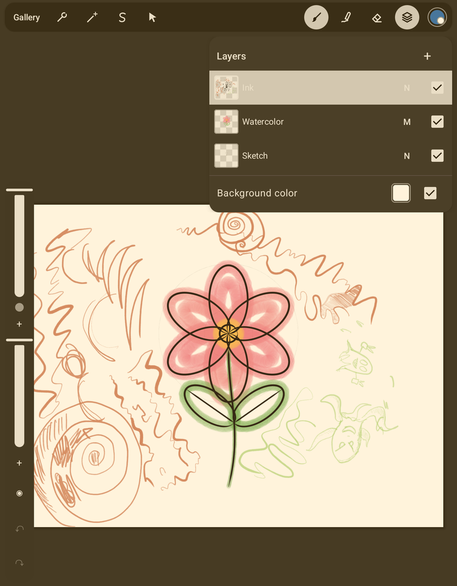
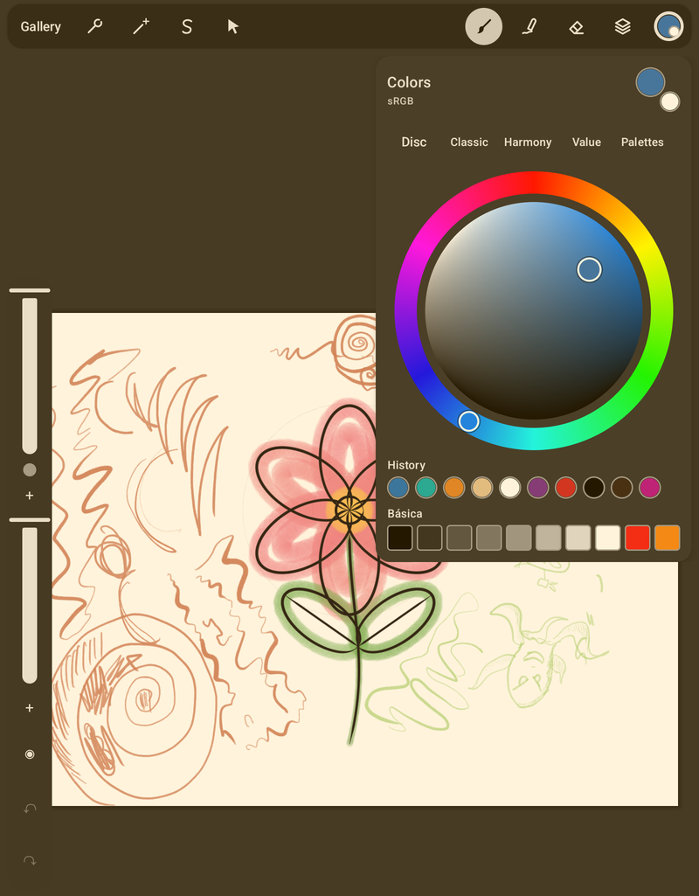
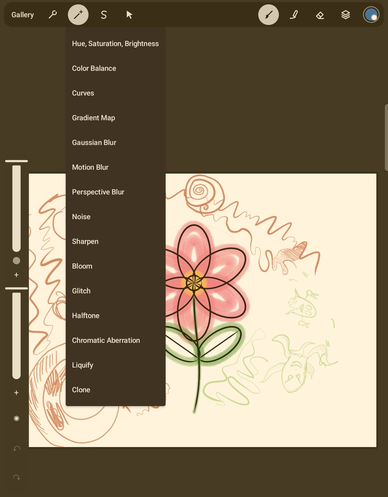
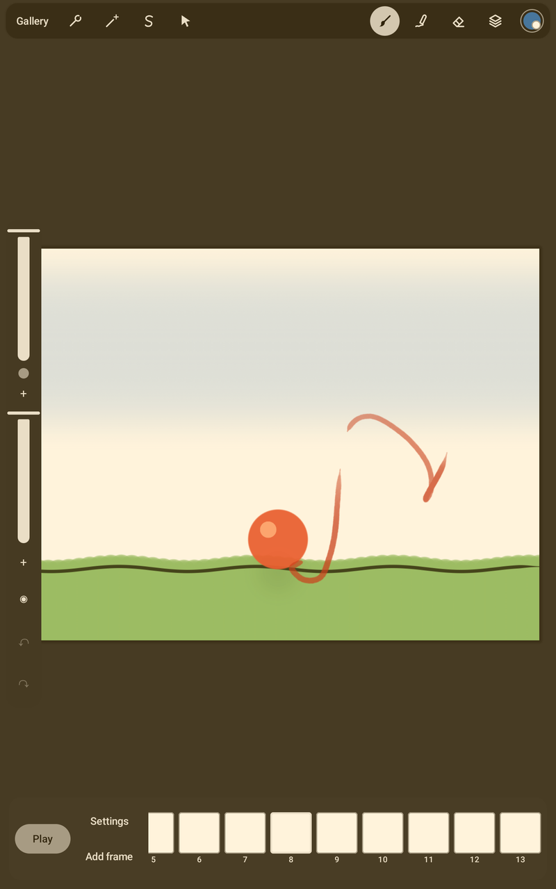

<p align="center">
  
</p>

<h1 align="center">Nanquim</h1>

<p align="center">
  Open-source raster painting app for Android tablets with a stylus.<br>
  Android 10+ · English and Brazilian Portuguese · MIT License
</p>

<p align="center">
  
</p>

<table>
  <tr>
    <td align="center"><br>Brush library</td>
    <td align="center"><br>Layers</td>
    <td align="center"><br>Colors</td>
  </tr>
  <tr>
    <td align="center"><br>Adjustments</td>
    <td align="center"><br>Animation</td>
    <td></td>
  </tr>
</table>

## Features

- **Painting:** brush library in groups (sketching, inking, painting, calligraphy, airbrushing, textures, charcoals and more), brush editor, stamps, `.brush`/`.brushset` import; paint, smudge, erase, fill and clone tools with pressure and tilt; QuickShape turns a held stroke into a clean line or shape.
- **Layers:** 27 blend modes, opacity, groups, masks, clipping, alpha lock, reference and private layers, text layers and video layers.
- **Selection and transform:** rectangle, ellipse, freehand and automatic selection, feather, saved selections; free, uniform, distort and warp transforms.
- **Adjustments:** hue/saturation/brightness, color balance, curves, gradient map, Gaussian/motion/perspective blur, noise, sharpen, bloom, glitch, halftone, chromatic aberration, liquify and clone, with a live preview.
- **Color:** disc, classic, harmony and value pickers, history, palettes (create, from an image, import ACO, ASE, GPL and `.swatches`), eyedropper and gradients.
- **Drawing aids:** grid, isometric, perspective and symmetry guides; reference window; text with imported TTF/OTF fonts.
- **Animation:** frames, onion skin, hold frames and playback; export as GIF, APNG, MP4 (H.264/HEVC), WebM or a PNG sequence.
- **Timelapse:** recording while you paint, replay and export (full or 30 s).
- **Color management:** 8 or 16 bits per channel, ICC profiles (sRGB, Display P3, Adobe RGB, Rec. 2020), CMYK canvas with soft proof.
- **Files:** native `.nanquim` documents with autosave; export PNG, JPEG, WebP, PSD, TIFF and PDF; import images, PSD, TIFF and `.procreate` files; gallery with stacks, search and the system file picker.
- **Workflow:** configurable gestures, radial quick menu, keyboard shortcuts, mouse and external display support, macros, canvas information, home-screen widget, phone layout.
- **Engine:** C++17 renderer on OpenGL ES 3.1 or Vulkan, with a tiled canvas.

## Building

Requirements: JDK 17+, Android SDK (platform 36), NDK 28.2.13676358, CMake 3.22.1. For host C++ tests: CMake ≥ 3.22, Ninja and a C++17 compiler on `PATH`.

```bash
./gradlew assembleDebug                              # build
./gradlew test :engine:hostTest :app:lintProdDebug   # JVM tests, C++ tests and golden images, lint
python3 tools/check_licenses.py                      # dependency and asset licenses
```

## Repository layout

| Path | Contents |
|---|---|
| `app/` | Android application (Compose UI, navigation, command wiring, diagnostics) |
| `document/` | Pure Kotlin: document model and command registry (JVM-testable) |
| `formats/` | Pure Kotlin readers/writers that do not need the engine |
| `engine/` | C++17 native engine (render thread, OpenGL ES and Vulkan) + Kotlin JNI facade |
| `benchmarks/` | Macrobenchmark journeys |
| `goldens/` | Golden image scenes and expected renders |
| `tools/` | Developer scripts (licenses, brushes, samples, device measurements, automation) |

## Diagnostics

Settings → long-press the app version opens the Diagnostics screen (device, GPU, displays, stylus, latency test, JSON export).

## Legal

MIT License (`LICENSE`). Not affiliated with any other app maker; see `NOTICE.md`. Third-party libraries and assets: `CREDITS.md`.
